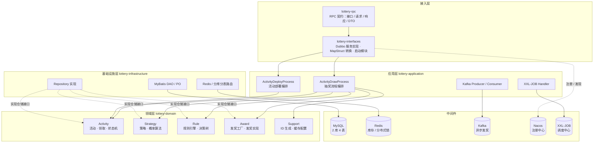
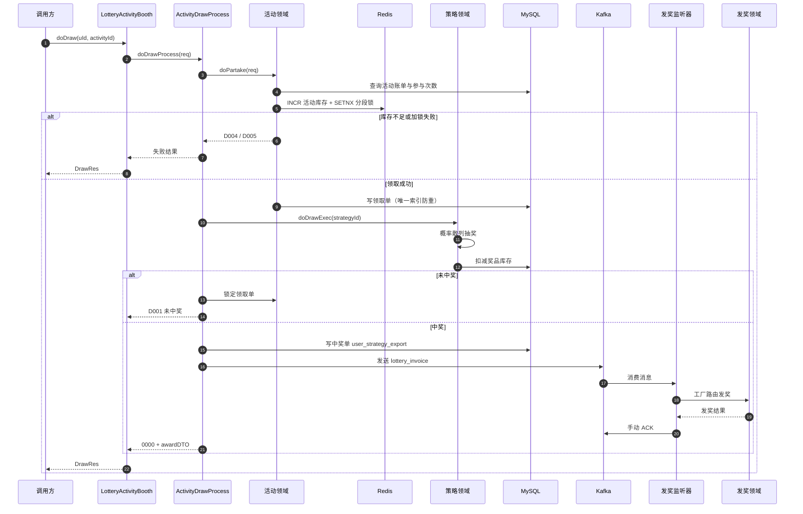

<div align="center">
  
  <h1>Lottery · 分布式抽奖系统</h1>
  <p><strong>基于 DDD 四层架构的互联网 C 端营销抽奖系统</strong></p>
  <p>概率抽奖 · 规则引擎 · 活动状态机 · 分库分表 · 消息驱动发奖</p>
</div>
<p align="center">
  
  
  
  
  
  <br/>
  
  
  
  
  
</p>

> **一句话介绍**：Lottery 覆盖「活动配置 → 活动审核 → 用户参与 → 概率抽奖 → 中奖记账 → 异步发奖」的完整链路，用 DDD 四层架构把复杂的营销抽奖业务拆解成可演进的领域模块。

Lottery 是一个面向电商、出行、本地生活等 C 端营销场景的分布式抽奖系统。系统覆盖活动配置、用户参与次数控制、多种概率抽奖策略、人群规则量化、中奖记录与奖品发放，并在工程实现中处理了库存扣减、并发防重、分库分表、消息补偿等真实业务问题。

本项目是我个人发起并持续维护的开源工程。我希望它既是一套可以运行、按需扩展的抽奖业务底座，也是一份完整的 DDD 落地样例：你可以在其中看到领域如何划分、设计模式如何应用、基础设施如何与领域解耦，以及高并发场景下做了哪些取舍。

如果这个项目对你有帮助，欢迎点一个 ⭐ Star，这是我持续维护最大的动力。

## 目录

- [项目简介](#项目简介) · [核心特性](#核心特性) · [技术栈](#技术栈) · [项目架构](#项目架构)
- [核心流程](#核心流程) · [工程目录](#工程目录) · [数据库设计](#数据库设计) · [环境配置](#环境配置)
- [快速开始](#快速开始) · [接口说明](#接口说明) · [设计亮点](#设计亮点) · [扩展指南](#扩展指南)
- [测试](#测试) · [开发规范](#开发规范) · [Roadmap](#roadmap) · [FAQ](#faq)
- [贡献指南](#贡献指南) · [License](#license) · [联系与致谢](#联系与致谢)

## 项目简介

营销抽奖看起来只是「点一下、转一圈」，但背后往往牵扯活动生命周期、奖品库存、概率模型、用户资格、发奖一致性和运营审计等一整套问题。Lottery 将这些关注点拆分为活动、策略、规则、发奖四个核心领域，并通过 RPC 对外提供能力。

项目主要面向以下场景：

- **技术实践**：想系统学习 DDD 分层、领域建模、设计模式落地的 Java 开发者。
- **业务复用**：需要一个可扩展的营销抽奖底座，再按自己的业务接入用户、奖品与订单体系。
- **作品展示**：作为分布式系统、营销业务或架构设计的个人作品与面试材料。

项目当前聚焦于**核心抽奖服务**，通过 Dubbo 暴露 RPC 接口。HTTP 网关、运营后台、H5 前端等接入层不在本仓库内，已列入 [Roadmap](#roadmap)。

## 核心特性

| 能力 | 实现要点 |
| :--- | :--- |
| 活动全生命周期 | 8 种活动状态 + 状态机约束，支持编辑、提审、撤审、审核、运行、关闭等流转 |
| 双概率抽奖模型 | 单项概率 / 总体概率两种策略，适配「奖品库存耗尽后是否重新分配概率」的不同运营诉求 |
| O(1) 抽奖定位 | 概率放大后填充散列表，结合斐波那契散列直接定位奖品，避免每次抽奖遍历奖品列表 |
| 可配置规则引擎 | 决策树存储在数据库，按 `ruleKey` 路由逻辑过滤器，支持年龄、性别等规则扩展 |
| 高并发库存控制 | Redis `INCR` 预占库存、`SETNX` 分段 Token 锁、数据库唯一索引最终防重 |
| 分库分表 | 中奖单按 `uId` 路由到 2 库 × 4 表，用户领取单与参与次数按用户维度拆分 |
| 异步发奖 | Kafka 解耦抽奖与发奖，消息发送状态落库，XXL-JOB 扫描失败消息进行补偿 |
| 可扩展奖品体系 | 工厂模式 + 策略实现，内置文字、兑换码、优惠券、实物四类奖品发放 |
| 完整工程实践 | 统一响应、MapStruct 对象转换、分层测试、Docker Compose 环境模板 |

## 技术栈

| 分类 | 技术 | 版本 | 用途 |
| :--- | :--- | :--- | :--- |
| 开发语言 | Java | 1.8 | 项目编译与运行基线 |
| 构建工具 | Maven | 3.6+ | 多模块聚合构建 |
| 基础框架 | Spring Boot | 2.6.0 | 应用容器与自动装配 |
| RPC 框架 | Apache Dubbo | 2.7.10 | 服务暴露、注册与调用 |
| 注册中心 | Nacos | 2.0.x | Dubbo 服务注册与发现 |
| 持久层 | MyBatis | 2.1.4 | SQL 映射与数据访问 |
| 数据库 | MySQL | 5.7+ | 活动、策略、领取单、中奖单存储 |
| 缓存 | Redis | 5.0+ | 活动库存预占与分布式锁 |
| 消息队列 | Kafka | 2.x | 领取记录与发奖消息异步解耦 |
| 任务调度 | XXL-JOB | 2.3.0 | 活动状态流转、MQ 消息补偿 |
| 分库分表 | db-router-spring-boot-starter | 1.0.1-SNAPSHOT | 按 `uId` 路由分库分表 |
| 对象映射 | MapStruct | 1.4.2.Final | DTO / VO / 领域对象转换 |
| JSON | Fastjson | 1.2.78 | 序列化与日志输出 |
| 工具库 | Hutool / Commons Lang3 | 5.5.0 / 3.8 | 常用工具方法 |
| 测试 | JUnit 4 / Spring Boot Test | 4.12 | 单元测试与集成测试 |

> 版本以根目录 `pom.xml` 的 `dependencyManagement` 为准。

## 项目架构

项目采用 **DDD 四层架构 + RPC 服务化** 组织代码。接入层只负责契约与协议适配，应用层负责用例编排，领域层承载核心业务规则，基础设施层提供存储、缓存与路由实现。



> 图中的箭头表示调用或实现关系；领域层通过仓储接口访问持久化，具体实现位于基础设施层。

**分层职责**

| 层次 | 模块 | 职责 | 关键类 |
| :--- | :--- | :--- | :--- |
| 接入层 | `lottery-rpc` / `lottery-interfaces` | 定义 RPC 契约，暴露 Dubbo 服务，完成协议与 DTO 转换 | `ILotteryActivityBooth`、`LotteryActivityBooth` |
| 应用层 | `lottery-application` | 编排用例流程，本身不承载领域规则 | `ActivityDrawProcessImpl`、`LotteryXxlJob` |
| 领域层 | `lottery-domain` | 活动、策略、规则、发奖的核心模型与领域服务 | `AbstractDrawBase`、`EngineBase`、`AbstractState` |
| 基础设施层 | `lottery-infrastructure` | 实现仓储接口，对接 MySQL、Redis 与分库分表 | `ActivityRepository`、`StrategyRepository` |
| 通用层 | `lottery-common` | 统一返回、常量、枚举、分页等通用能力 | `Result`、`Constants` |

> **核心依赖方向**：`lottery-interfaces` → `lottery-application` → `lottery-domain`；`lottery-infrastructure` 实现 `lottery-domain` 定义的仓储接口。领域层不感知 MyBatis、Redis 等基础设施细节，应用层通过领域服务完成编排，仓储实现由 Spring 在运行时注入。

**领域划分**

| 领域 / 模块 | 核心模型 | 职责 |
| :--- | :--- | :--- |
| Activity | `ActivityConfigRich`、`ActivityBillVO`、`UserTakeActivityVO` | 活动配置、部署、参与、领取单与状态流转 |
| Strategy | `StrategyRich`、`AwardRateVO`、`DrawAwardVO` | 抽奖策略、概率算法、抽奖模板与结果组装 |
| Rule | `TreeRuleRich`、`TreeNodeVO`、`DecisionMatterReq` | 决策树规则、人群量化、逻辑过滤器 |
| Award | `GoodsReq`、`DistributionRes` | 发奖工厂、发奖实现与发奖状态 |
| Support | `IIdGenerator`、`IdContext` | 雪花算法、短码、随机数等 ID 生成策略 |

## 核心流程

一次完整的抽奖请求会经过以下步骤：

1. **活动校验**：查询活动账单，校验活动状态、起止时间、活动库存与个人剩余参与次数。
2. **领取活动**：通过 Redis 预占活动库存，生成领取单并写入数据库；唯一索引防止重复领取。首次领取成功时发送 `lottery_activity_partake` 消息，异步回写数据库活动库存。
3. **执行抽奖**：根据活动绑定的 `strategyId` 加载策略与概率数据，执行单项或总体概率抽奖，并扣减奖品库存。
4. **结果落库**：中奖时写入中奖单并锁定领取单；未中奖时将领取单标记为已使用并返回未中奖结果。
5. **异步发奖**：将发奖消息发送到 Kafka，消费端根据奖品类型路由到具体发奖实现。
6. **补偿兜底**：MQ 发送状态落库，XXL-JOB 扫描发送失败的消息重新投递；活动状态也由定时任务自动流转。



## 工程目录

```text
Lottery
├── pom.xml                              # Maven 聚合工程，统一依赖与插件版本
├── lottery-common/                      # 通用层：统一返回、常量、枚举、分页
│   └── src/main/java/cn/itedus/lottery/common/
│       ├── Constants.java
│       ├── PageRequest.java
│       └── Result.java
├── lottery-rpc/                         # RPC 契约层：接口、请求、响应、DTO
│   └── src/main/java/cn/itedus/lottery/rpc/activity/
│       ├── booth/                       # 抽奖展台契约
│       └── deploy/                      # 活动部署契约
├── lottery-domain/                      # 领域层：核心业务模型与领域服务
│   └── src/main/java/cn/itedus/lottery/domain/
│       ├── activity/                    # 活动领域
│       │   ├── model/                   # 聚合、请求、响应、VO
│       │   ├── repository/              # 仓储接口
│       │   └── service/                 # 参与、部署、状态机
│       ├── strategy/                    # 策略领域
│       │   ├── annotation/              # @Strategy 策略标记
│       │   ├── model/                   # 策略聚合与抽奖模型
│       │   └── service/                 # 抽奖模板、概率算法
│       ├── rule/                        # 规则领域
│       │   ├── model/                   # 决策树模型
│       │   └── service/                 # 规则引擎、逻辑过滤器
│       ├── award/                       # 发奖领域
│       │   ├── model/                   # 发奖请求与结果
│       │   └── service/                 # 发奖工厂、发奖实现
│       └── support/                     # 支撑能力：ID 生成、Redis 配置
├── lottery-application/                 # 应用层：流程编排、消息、定时任务
│   └── src/main/java/cn/itedus/lottery/application/
│       ├── process/                     # 抽奖与活动部署流程
│       ├── mq/                          # Kafka 生产者与消费者
│       └── worker/                      # XXL-JOB 任务与配置
├── lottery-infrastructure/              # 基础设施层：仓储、DAO、PO、缓存
│   └── src/main/java/cn/itedus/lottery/infrastructure/
│       ├── dao/                         # MyBatis Mapper 接口
│       ├── po/                          # 数据库持久化对象
│       ├── repository/                  # 领域仓储实现
│       └── util/                        # Redis 工具
├── lottery-interfaces/                  # 接入层 + 启动模块
│   ├── src/main/java/cn/itedus/lottery/
│   │   ├── LotteryApplication.java      # Spring Boot 启动类
│   │   └── interfaces/
│   │       ├── facade/                  # Dubbo 服务实现
│   │       └── assembler/               # MapStruct 对象转换
│   ├── src/main/resources/
│   │   ├── application.yml              # 应用主配置
│   │   └── mybatis/                     # Mapper XML 与 MyBatis 配置
│   └── src/test/java/                   # 分层测试用例
├── doc/
│   ├── assets/sql/                      # 建库建表与初始化数据
│   ├── docker/                          # Docker Compose 环境模板
│   └── notes/                           # 设计与使用笔记
├── .gitignore
├── LICENSE
└── README.md
```

| 模块 | 打包 | 说明 |
| :--- | :---: | :--- |
| `lottery-common` | jar | 无业务依赖的通用能力，供其他模块复用 |
| `lottery-rpc` | jar | 只包含 RPC 契约与 DTO，便于外部服务引用 |
| `lottery-domain` | jar | 业务核心，包含领域模型、领域服务与仓储接口 |
| `lottery-application` | jar | 用例编排、Kafka 消息处理、XXL-JOB 任务 |
| `lottery-infrastructure` | jar | 仓储实现、MyBatis DAO、PO、Redis 工具 |
| `lottery-interfaces` | war | 启动模块，聚合所有业务模块并暴露 Dubbo 服务 |

## 数据库设计

项目使用 3 个数据库：`lottery` 保存活动与规则配置，`lottery_01`、`lottery_02` 保存按用户维度拆分的领取与中奖数据。

| 数据库 | 表名 | 说明 |
| :--- | :--- | :--- |
| `lottery` | `activity`、`award`、`strategy`、`strategy_detail` | 活动、奖品、抽奖策略与概率明细 |
| `lottery` | `rule_tree`、`rule_tree_node`、`rule_tree_node_line` | 规则决策树的根、节点与连线 |
| `lottery_01` / `lottery_02` | `user_take_activity` | 用户领取单，包含领取时间、策略、状态与防重 `uuid` |
| `lottery_01` / `lottery_02` | `user_take_activity_count` | 用户在某活动下的总次数与剩余次数 |
| `lottery_01` / `lottery_02` | `user_strategy_export_000` ~ `user_strategy_export_003` | 中奖与发奖单，按 `uId` 路由到 2 库 × 4 表 |

SQL 脚本位于 [`doc/assets/sql`](doc/assets/sql)，Docker 环境副本位于 [`doc/docker/mysql/db`](doc/docker/mysql/db)。

## 环境配置

### 1. 基础环境

| 组件 | 版本要求 | 是否必需 | 说明 |
| :--- | :--- | :---: | :--- |
| JDK | 1.8 | 是 | 编译目标为 Java 8，建议使用 8u301 及以上 |
| Maven | 3.6+ | 是 | 建议配置国内镜像加速依赖下载 |
| MySQL | 5.7+ / 8.0 | 是 | 默认使用 MySQL 5.x 驱动 |
| Redis | 5.0+ | 是 | 活动库存预占与分段锁 |
| Nacos | 2.0.x | 是 | Dubbo 注册中心 |
| Kafka | 2.x | 是 | 需要配套 ZooKeeper |
| XXL-JOB | 2.3.0 | 建议 | 活动状态流转与 MQ 补偿 |
| Docker | 20.10+ | 可选 | 快速拉起本地中间件 |

本地同时运行 MySQL、Redis、Nacos、Kafka、XXL-JOB 时，建议至少 **2 核 4G** 内存。

### 2. 中间件与端口

| 服务 | 默认端口 | 说明 |
| :--- | :--- | :--- |
| MySQL | `3306` | 3 个数据库：`lottery`、`lottery_01`、`lottery_02` |
| Redis | `6379` | 默认无密码 |
| Nacos | `8848` / `9848` / `9849` | Nacos 2.x 额外占用 gRPC 端口 |
| ZooKeeper | `2181` | Kafka 依赖 |
| Kafka | `9092` | 需要创建两个 Topic |
| XXL-JOB Admin | `7397` | 官方默认 8080，本项目按 7397 配置 |
| Lottery 应用 | `8081` | HTTP 端口；Dubbo 端口由 `-1` 随机分配 |

### 3. 应用配置

主配置文件：`lottery-interfaces/src/main/resources/application.yml`。

| 配置项 | 默认值 | 说明 |
| :--- | :--- | :--- |
| `server.port` | `8081` | 应用 HTTP 端口 |
| `spring.redis.host` / `port` | `127.0.0.1` / `6379` | Redis 地址 |
| `spring.kafka.bootstrap-servers` | `127.0.0.1:9092` | Kafka 地址 |
| `dubbo.registry.address` | `nacos://127.0.0.1:8848` | Dubbo 注册中心 |
| `mini-db-router.jdbc.datasource.dbCount` | `2` | 分库数量 |
| `mini-db-router.jdbc.datasource.tbCount` | `4` | 每个库的分表数量 |
| `mini-db-router.jdbc.datasource.routerKey` | `uId` | 分库分表路由键 |
| `xxl.job.admin.addresses` | `http://127.0.0.1:7397/xxl-job-admin` | 调度中心地址 |
| `xxl.job.executor.appname` | `lottery-job` | 执行器名称 |
| `xxl.job.executor.logpath` | 示例路径 | **必须改为本机可写目录** |
| `nacos.discovery.server-addr` | `127.0.0.1:8848` | Nacos 服务地址 |

核心配置示例：

```yaml
server:
  port: 8081

spring:
  redis:
    host: 127.0.0.1
    port: 6379
  kafka:
    bootstrap-servers: 127.0.0.1:9092

dubbo:
  registry:
    address: nacos://127.0.0.1:8848

mini-db-router:
  jdbc:
    datasource:
      dbCount: 2
      tbCount: 4
      default: db00
      routerKey: uId
      list: db01,db02
```

## 快速开始

### 1. 克隆仓库

```bash
git clone https://github.com/strugglesky/Lottery.git
cd Lottery
```

### 2. 安装本地依赖

项目使用分库分表路由组件 `db-router-spring-boot-starter`（版本 `1.0.1-SNAPSHOT`）完成按用户维度路由，该组件未发布到 Maven Central。首次构建前，请先获取组件源码，并在其根目录执行：

```bash
mvn clean install -DskipTests
```

安装成功后，再回到本项目根目录构建。如果团队使用私有 Nexus，也可以将组件部署到私有仓库后统一引用。

### 3. 初始化数据库

```bash
mysql -uroot -p < doc/assets/sql/lottery.sql
mysql -uroot -p < doc/assets/sql/lottery_01.sql
mysql -uroot -p < doc/assets/sql/lottery_02.sql
```

如需启用 XXL-JOB，再导入调度中心的表结构：

```bash
mysql -uroot -p < doc/assets/sql/xxl-job.sql
```

### 4. 启动中间件

至少启动 MySQL、Redis、Nacos、ZooKeeper 与 Kafka。仓库提供了一份 Docker Compose 环境模板：

```bash
cd doc/docker
# 启动前请先修改 docker-compose.yml 中的数据库密码等占位配置
docker compose up -d lottery-mysql lottery-redis lottery-nacos lottery-zookeeper lottery-kafka
```

> Compose 文件同时包含 API、ERP 等服务模板，本步骤只启动基础中间件。使用 Docker Compose v1 时，将 `docker compose` 替换为 `docker-compose`。

### 5. 创建 Kafka Topic

在 Kafka 安装目录或容器内执行以下命令，两个 Topic 分别承载「首次领取活动记录」与「中奖发奖消息」：

```bash
kafka-topics.sh --create --bootstrap-server 127.0.0.1:9092 \
  --topic lottery_activity_partake --partitions 1 --replication-factor 1

kafka-topics.sh --create --bootstrap-server 127.0.0.1:9092 \
  --topic lottery_invoice --partitions 1 --replication-factor 1
```

### 6. 初始化 XXL-JOB（可选）

1. 使用官方发行包或容器启动 XXL-JOB Admin，将端口映射为 `7397`（或按实际端口修改配置），访问 `http://127.0.0.1:7397/xxl-job-admin`。
2. 新建执行器，AppName 填写 `lottery-job`，注册方式选择自动注册。
3. 新建两个任务，JobHandler 分别填写：
   - `lotteryActivityStateJobHandler`：扫描活动状态，建议每分钟执行一次。
   - `lotteryOrderMQStateJobHandler`：扫描发送失败的 MQ 消息，参数示例 `1,2`，建议每 5 分钟执行一次。
4. 确认 `application.yml` 中的 `xxl.job.accessToken` 与调度中心一致。

不启动 XXL-JOB 不影响主抽奖链路，但活动状态自动流转与 MQ 补偿将不可用。

### 7. 修改应用配置

打开 `lottery-interfaces/src/main/resources/application.yml`，至少确认以下内容：

- MySQL 三个数据源的地址、用户名与密码。
- Redis、Kafka、Nacos 地址。
- `xxl.job.executor.logpath` 改为本机可写目录。
- `xxl.job.accessToken` 与调度中心保持一致。

### 8. 构建与启动

在项目根目录执行：

```bash
mvn clean install -DskipTests
```

启动方式二选一：

```bash
# 方式一：Maven 启动
mvn -pl lottery-interfaces spring-boot:run

# 方式二：构建后运行可执行 WAR
java -jar lottery-interfaces/target/Lottery.war
```

也可以在 IDE 中直接运行 `cn.itedus.lottery.LotteryApplication`。

### 9. 验证链路

启动成功后，运行接口测试：

```bash
mvn -pl lottery-interfaces test \
  -Dtest=LotteryActivityBoothTest \
  -DskipTests=false
```

测试会调用 `doDraw` 与 `doQuantificationDraw`，日志中可以看到领取活动、执行策略、记录中奖单与发送 MQ 的完整过程。

## 接口说明

本仓库通过 Dubbo 暴露两个 RPC 接口，当前能力聚焦于抽奖与活动分页查询；活动创建 / 编辑的对外接口会在运营后台接入时补充。

| 接口 | 方法 | 说明 |
| :--- | :--- | :--- |
| `ILotteryActivityBooth` | `doDraw(DrawReq)` | 指定活动抽奖 |
| `ILotteryActivityBooth` | `doQuantificationDraw(QuantificationDrawReq)` | 先通过规则引擎量化人群，再对命中的活动抽奖 |
| `ILotteryActivityDeploy` | `queryActivityListByPageForErp(ActivityPageReq)` | 分页查询活动列表，供运营侧使用 |

调用示例：

```java
@DubboReference
private ILotteryActivityBooth lotteryActivityBooth;

public DrawRes draw() {
    DrawReq req = new DrawReq();
    req.setuId("user-1001");
    req.setActivityId(100001L);

    DrawRes res = lotteryActivityBooth.doDraw(req);
    System.out.println(JSON.toJSONString(res));
    return res;
}
```

量化人群抽奖示例：

```java
QuantificationDrawReq req = new QuantificationDrawReq();
req.setuId("user-1001");
req.setTreeId(2110081902L);

Map<String, Object> valMap = new HashMap<>();
valMap.put("gender", "man");
valMap.put("age", "18");
req.setValMap(valMap);

DrawRes res = lotteryActivityBooth.doQuantificationDraw(req);
```

中奖响应示例：

```json
{
  "code": "0000",
  "info": "成功",
  "awardDTO": {
    "userId": "user-1001",
    "activityId": 100001,
    "awardId": "2",
    "awardType": 1,
    "awardName": "iphone",
    "awardContent": "Code",
    "strategyMode": 2,
    "grantType": 1,
    "grantDate": 1690000000000
  }
}
```

常用响应码：

| 编码 | 含义 | 说明 |
| :---: | :--- | :--- |
| `0000` | 成功 | 正常返回，中奖时携带 `awardDTO` |
| `0001` | 未知失败 | 系统异常或未捕获错误 |
| `0003` | 主键冲突 | 唯一索引触发，通常是重复领取 |
| `0004` | SQL 操作无更新 | 库存或状态已被其他请求修改 |
| `D001` | 未中奖 | 抽奖结果为空 |
| `D002` | 规则执行失败 | 决策树不存在或规则无法匹配 |
| `D003` | 存在未消费领取记录 | 可直接复用 `takeId` 继续抽奖 |
| `D004` | 活动无库存 | Redis 预占库存超过活动总量 |
| `D005` | 分布式锁失败 | 分段 Token 已被占用，可重试 |

## 设计亮点

### DDD 分层：领域层不依赖基础设施

`lottery-domain` 只定义 `IActivityRepository`、`IStrategyRepository` 等仓储接口，`lottery-infrastructure` 负责提供实现。领域服务通过接口访问持久化，不感知 MyBatis、Redis 或分库分表的存在。这样在替换存储、增加缓存或拆分服务时，领域代码可以保持稳定。

### 模板方法 + 策略模式：流程稳定，算法可插拔

抽奖的主流程固定为「加载策略 → 初始化概率 → 排除不可用奖品 → 执行算法 → 组装结果」，由 `AbstractDrawBase` 定义模板；具体使用哪种算法由策略模式决定：

```java
public abstract class AbstractDrawBase implements IDrawExec {

    // doDrawExec 定义固定模板：加载策略 → 初始化概率 → 排除奖品 → 执行算法 → 组装结果

    protected abstract List<String> queryExcludeAwardIds(Long strategyId);

    protected abstract String drawAlgorithm(Long strategyId,
                                            IDrawAlgorithm drawAlgorithm,
                                            List<String> excludeAwardIds);
}
```

算法实现通过 `@Strategy(strategyMode = ...)` 标注，`DrawConfig` 在启动时扫描并注册到 `drawAlgorithmGroup`。新增算法不需要修改调用方。

### O(1) 概率定位：斐波那契散列

单项概率模式下，系统把概率放大 100 倍后填充到长度为 128 的散列表中。例如某奖品中奖率为 5%，就占用 5 个槽位；抽奖时生成 1~100 的随机数，再通过 `hashIdx` 计算数组下标，直接得到奖品 ID。

```java
private final int HASH_INCREMENT = 0x61c88647; // 黄金分割相关常量
private final int RATE_TUPLE_LENGTH = 128;

protected int hashIdx(int val) {
    int hashCode = val * HASH_INCREMENT + HASH_INCREMENT;
    return hashCode & (RATE_TUPLE_LENGTH - 1);
}
```

两种概率模型的差异：

- **单项概率**：奖品库存耗尽后，该奖品仍占用原有概率区间，命中时返回未中奖，运营成本更可控。
- **总体概率**：奖品库存耗尽后，从奖品池中移除该奖品，并把剩余概率按比例重新分配，保证「只要还有奖品就尽量中奖」。

### 规则引擎：把人群判断从代码搬到配置

`rule_tree`、`rule_tree_node`、`rule_tree_node_line` 三张表描述一棵决策树。`EngineBase` 从根节点开始循环：遇到 `STEM` 节点时，根据 `ruleKey` 找到对应的 `LogicFilter`，计算 `matterValue` 并选择下一节点；遇到 `FRUIT` 节点时返回节点值，即目标活动 ID。

新增规则只需要：

1. 继承 `BaseLogic`，实现 `matterValue`。
2. 在 `EngineConfig#init` 中注册 `ruleKey`。
3. 在规则表中配置节点与连线。

### 状态机：让活动流转可约束、可追踪

活动包含编辑、提审、撤审、通过、运行、拒绝、关闭、开启 8 种状态。状态机为流转节点提供了对应的 `AbstractState` 子类，`StateConfig` 在启动时注册到状态 Map。非法流转会返回失败，而不是直接修改数据库。

XXL-JOB 会定时扫描活动：将「审核通过」推进为「活动中」，超过结束时间后将「活动中」关闭为「已关闭」，减少人工操作。

### Redis 库存：先预占，再落库

领取活动时，系统先用 `INCR` 预占活动库存：

- 如果占用数超过活动总库存，立即 `DECR` 回滚并返回 `D004`。
- 如果预占成功，以「活动 ID + 占用序号」生成 Token，通过 `SETNX` 加锁，锁的过期时间设置为活动结束时间。
- 流程结束后清理 Token；写入失败则返回对应错误码。

数据库侧为领取单建立了防重唯一索引，用于拦截同一领取序号的重复写入。这里的取舍是**优先保证不超卖**，库存的最终一致性可以继续通过对账任务完善。

### 分库分表：按用户维度水平拆分

中奖单按 `uId` 路由到 2 个库、每个库 4 张分表，共 8 个分片。路由组件使用哈希散列与扰动函数计算库表下标，使数据分布更均匀。用户领取单与参与次数表也按用户维度存放在对应库中。

XXL-JOB 的 MQ 补偿任务会按照「库 + 表」的维度逐个扫描，避免一次加载全量数据。

### 最终一致性：本地消息状态 + 定时补偿

中奖后，系统先把中奖单写入数据库，`mq_state` 初始为 0，再发送 Kafka 消息：

- Kafka 发送成功，回写 `mq_state = 1`。
- Kafka 发送失败，回写 `mq_state = 2`。
- `lotteryOrderMQStateJobHandler` 定时扫描发送失败（`mq_state = 2`）以及长时间停留在初始状态的记录，并重新投递。

消费端使用手动 ACK，发奖异常时抛出错误触发重试。由于消息可能重复投递，发奖实现需要保证幂等，例如按 `takeId` / `orderId` 做唯一约束或状态判断。

## 扩展指南

### 新增抽奖算法

1. 在 `lottery-domain` 中创建算法类，继承 `BaseAlgorithm` 并实现 `randomDraw`。
2. 使用 `@Component` 注册为 Spring Bean，并添加 `@Strategy(strategyMode = ...)`。
3. 如果是全新模式，在 `Constants.StrategyMode` 中补充枚举值。
4. `DrawConfig` 会自动扫描注册，无需修改调用方。

### 新增奖品类型

1. 实现 `IDistributionGoods`，可以直接继承 `DistributionBase` 复用通用逻辑。
2. 在 `Constants.AwardType` 中增加奖品类型枚举。
3. 在 `GoodsConfig#init` 中把实现注册到 `goodsMap`。
4. 配置奖品类型后，`DistributionGoodsFactory` 会自动路由到对应实现。

### 新增规则过滤器

1. 继承 `BaseLogic`，实现 `matterValue` 方法，从决策物料中提取需要比较的值。
2. 在 `EngineConfig#init` 中注册 `ruleKey`。
3. 在 `rule_tree_node` 与 `rule_tree_node_line` 中配置节点、比较类型与目标节点。

## 测试

项目按 DDD 分层组织测试，覆盖领域算法、规则引擎、基础设施与 RPC 接口：

| 测试范围 | 测试类 | 覆盖内容 |
| :--- | :--- | :--- |
| 领域算法 | `DrawAlgorithmTest` | 概率算法、排除奖品后的抽奖结果 |
| 规则引擎 | `RuleTest` | 决策树路径、年龄与性别规则匹配 |
| 活动领域 | `ActivityTest` | 活动状态流转、活动领取 |
| 基础设施 | `ActivityDaoTest`、`UserTakeActivityDaoTest`、`UserStrategyExportDaoTest` | DAO 查询、分库分表写入 |
| 接口层 | `LotteryActivityBoothTest`、`LotteryActivityDeployTest` | RPC 门面、参数转换 |
| 应用层 | `ActivityProcessTest`、`KafkaProducerTest` | 流程编排、消息发送 |

执行全部测试：

```bash
mvn test -DskipTests=false
```

执行单个测试类：

```bash
mvn -pl lottery-interfaces test \
  -Dtest=DrawAlgorithmTest \
  -DskipTests=false
```

> 根 POM 默认配置了 `skipTests=true`，所以直接执行 `mvn test` 不会运行测试，需要显式指定 `-DskipTests=false`。部分测试依赖 MySQL、Redis、Kafka 等中间件，建议先完成环境配置。

## 开发规范

### 分支命名

| 类型 | 示例 |
| :--- | :--- |
| 新功能 | `feature/rule-engine` |
| 问题修复 | `fix/stock-rollback` |
| 文档更新 | `docs/quick-start` |
| 代码重构 | `refactor/draw-template` |

### 提交信息

采用 Conventional Commits 风格：

```text
feat: 新增总体概率抽奖算法
fix: 修复领取单重复写入问题
docs: 补充本地环境配置说明
refactor: 拆分抽奖流程编排
test: 补充规则引擎单元测试
```

提交 PR 前，请确认：

- 没有破坏 `interfaces → application → domain` 的依赖方向。
- 领域层没有直接依赖 MyBatis、Redis 等基础设施实现。
- 新增逻辑有对应的测试或验证步骤。
- 配置项、SQL 或接口契约变更已同步更新文档。

## Roadmap

- [x] DDD 四层工程骨架与 Dubbo RPC 服务
- [x] 活动状态机、参与抽奖与领取单管理
- [x] 单项概率 / 总体概率抽奖算法
- [x] 规则引擎与人群量化
- [x] Redis 库存预占与分库分表
- [x] Kafka 异步发奖与 MQ 状态补偿
- [x] 分层测试与 Docker Compose 环境模板
- [ ] HTTP 网关 API（H5、小程序等接入场景）
- [ ] 活动创建 / 编辑 RPC 与运营后台接入
- [ ] 库存对账与自动修复任务
- [ ] 将分库分表路由能力内聚到仓库，去除外部 Snapshot 依赖
- [ ] 压测与性能调优（JMeter / Gatling）
- [ ] 可观测性建设（指标、日志、链路追踪）
- [ ] Testcontainers 一键集成测试
- [ ] 容器镜像与 Kubernetes 部署清单

## FAQ

### 构建时提示找不到 `db-router-spring-boot-starter`

该组件未发布到 Maven Central，需要先在组件源码目录执行 `mvn clean install -DskipTests`，安装到本地 Maven 仓库后再构建本项目。如果多人协作，建议部署到私有 Nexus。

### Nacos 启动正常，但 Dubbo 注册失败

- 确认 `dubbo.registry.address` 为 `nacos://127.0.0.1:8848`。
- Nacos 2.x 除了 8848，还需要开放 9848、9849 端口；Docker 部署时三个端口都要映射。
- 检查 `nacos.discovery.server-addr` 是否与注册中心地址一致。

### 启动或抽奖时提示 Kafka Topic 不存在

先按[快速开始](#快速开始)创建 `lottery_activity_partake` 与 `lottery_invoice` 两个 Topic，再确认 `spring.kafka.bootstrap-servers` 指向正确的 Kafka 地址。消费者组名为 `lottery`。

### 使用 MySQL 8.x 启动报驱动或时区错误

默认依赖是 MySQL 5.x 驱动。切换到 MySQL 8.x 时需要：

1. 将 `mysql-connector-java` 升级到 `8.0.x`。
2. 将驱动类改为 `com.mysql.cj.jdbc.Driver`。
3. 在 JDBC URL 中补充 `serverTimezone=Asia/Shanghai&useSSL=false&allowPublicKeyRetrieval=true`。

### 执行 `mvn test` 没有运行任何测试

根 POM 配置了 `skipTests=true`，使用 `mvn test -DskipTests=false` 显式关闭跳过。

### XXL-JOB 执行器注册不上

- 检查 `xxl.job.admin.addresses` 是否能访问。
- 确认 `xxl.job.accessToken` 与调度中心一致。
- 确认 `xxl.job.executor.logpath` 存在且可写。
- 确认执行器端口 `9998` 未被占用。

### 抽奖返回 `D004` 或 `D005`

- `D004`：活动库存不足。检查 `lottery_activity_stock_count_{activityId}` 是否已达到活动总库存，必要时补充库存或重置缓存。
- `D005`：分段 Token 加锁失败，通常是并发竞争导致。可以重试，或检查上一次请求是否异常退出、Token 未清理。

### Redis 库存与数据库库存不一致

Redis 承担热点库存预占，数据库库存是最终记账依据。出现差异时，建议先停止写入流量，核对 Redis 计数与数据库剩余库存，再按实际值重置缓存。生产环境建议补充定时对账与自动修复任务。

## 贡献指南

欢迎通过 Issue 或 Pull Request 参与项目建设。

1. Fork 本仓库并克隆到本地。
2. 从 `main` 分支创建功能分支，例如 `feature/your-feature`。
3. 完成代码与测试，确保本地构建通过。
4. 提交 PR，并在描述中说明背景、改动点、验证方式与可能的影响范围。
5. 如果涉及数据库或配置变更，请同步更新 SQL 脚本与 README。

提交 Issue 时，请尽量附上：

- 操作系统、JDK、Maven、MySQL、Redis、Kafka 等版本信息。
- 复现步骤与关键日志。
- 期望结果与实际结果。

## License

本项目基于 [Apache License 2.0](LICENSE) 开源。你可以自由使用、修改和分发代码，但请保留版权声明与许可证文本。

## 联系与致谢

- GitHub：[@strugglesky](https://github.com/strugglesky)
- 问题反馈：[Issues](https://github.com/strugglesky/Lottery/issues)
- 仓库地址：[https://github.com/strugglesky/Lottery](https://github.com/strugglesky/Lottery)

如果这个项目对你有帮助，欢迎 Star ⭐、Fork 或分享给需要的朋友。也感谢所有开源项目与社区文档提供的灵感与参考。

> **免责声明**：本项目为个人技术实践与开源分享，默认不提供生产级 SLA。用于生产环境前，请结合业务规模补充安全、合规、容量规划、监控告警与数据备份等设计。
